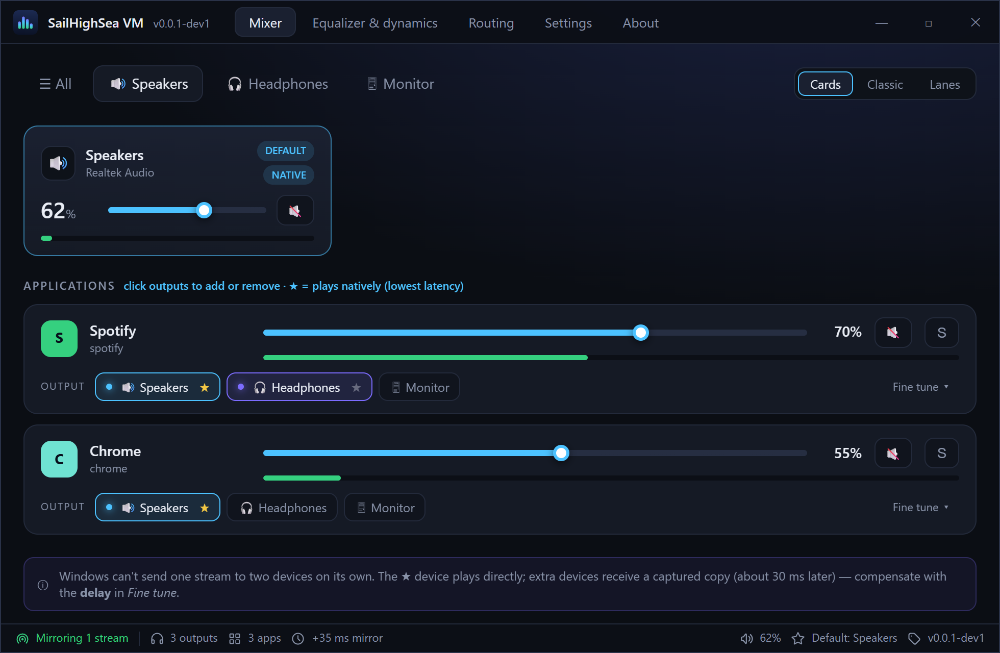
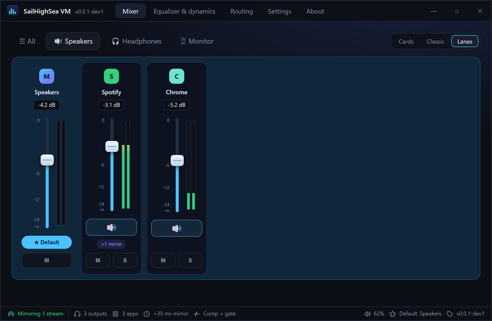
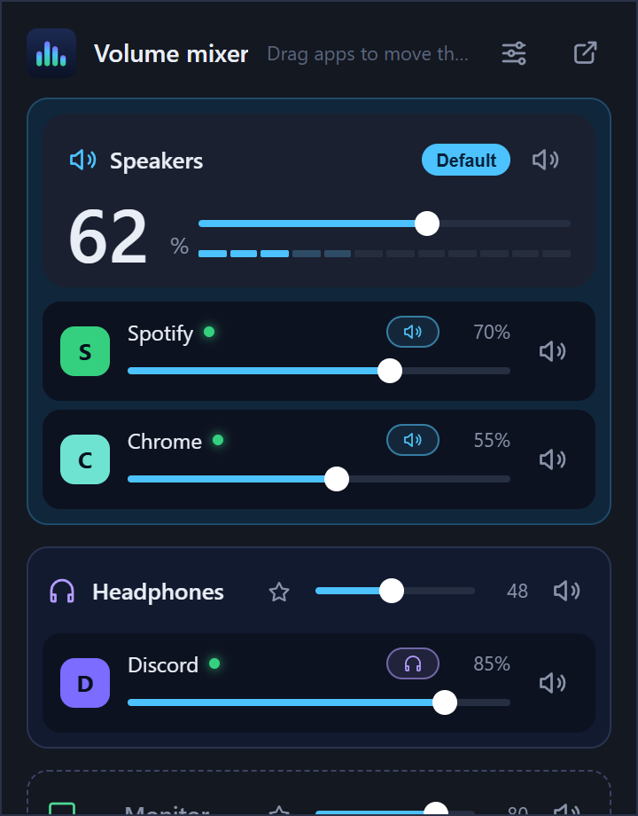
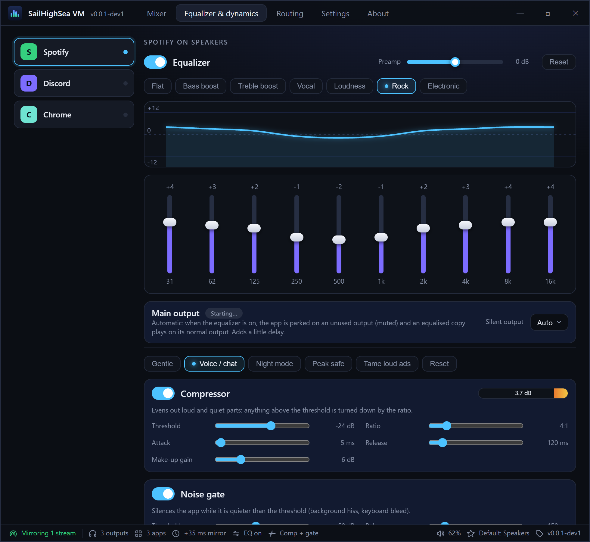
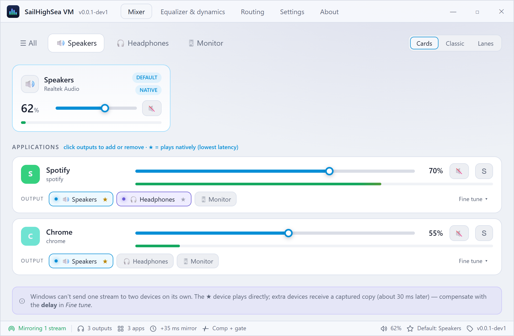
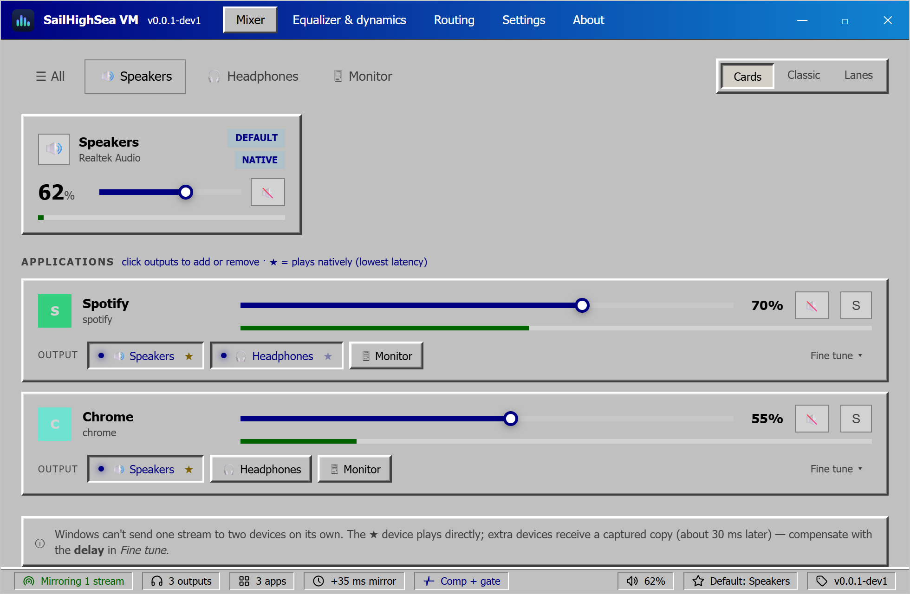

<p align="center"></p>

# SailHighSea VM

### Every app. Every output. One mixer.

A free, lightweight voice meter and volume mixer for Windows, Linux and macOS, built with Rust and Tauri.

[](https://github.com/SailHighSea/sailhighsea-vm/releases)
[](https://github.com/SailHighSea/sailhighsea-vm/actions/workflows/release.yml)


[](LICENSE)

<p align="center"><a href="docs/mixer.png"></a></p>

[Why](#why-sailhighsea-vm) · [Download](#download) · [Features](#features) · [How it works](#how-it-works) · [Roadmap](#roadmap) · [Build from source](#build-from-source) · [Files](#files-next-to-the-executable)

---

## Why SailHighSea VM

Windows gives you one volume slider per app and one default output. If you want the game on your headset, music on the speakers and a call on both, you end up digging through settings. SailHighSea VM puts every output device and every playing app in one window, and a quick popup in your tray.

- Set the volume of every app and output in one place.
- Move an app to another output by dragging it.
- Play one app on several outputs at once, with a delay trim to line them up.
- Shape an app's sound with an equalizer, compressor, noise gate and limiter.

## Download

Get the installer for your system from the [Releases page](https://github.com/SailHighSea/sailhighsea-vm/releases).

| Platform | Download |
|----------|----------|
| Windows 10 / 11 (64-bit Intel / AMD) | `SailHighSea-VM_windows-x64.exe` |
| Windows 11 on ARM | `SailHighSea-VM_windows-arm64.exe` |
| Linux | `SailHighSea-VM_linux-x64.AppImage` |
| macOS, Apple Silicon | `SailHighSea-VM_macos-arm64.zip` |
| macOS, Intel | `SailHighSea-VM_macos-x64.zip` |

**Every release is portable.** There is no installer: put the file in any folder (a USB stick works too) and run it. The settings (`sailhighsea-vm.ini`) and logs are saved in the same folder, so delete the folder to remove everything. On Linux make the AppImage executable first (`chmod +x`); on macOS unzip it and open the app (you may need to right-click, then *Open*, the first time because the build isn't signed).

> **Note**
> Download only from the official [Releases page](https://github.com/SailHighSea/sailhighsea-vm/releases). Builds are test versions named `v0.0.1-dev1`, `v0.0.1-dev2` and so on. The app checks the releases for a newer version (see *About*).

| Platform | Output devices | Per-app volume | Move app to another output | Level meters |
|----------|:---:|:---:|:---:|:---:|
| Windows (WASAPI)            | all active | yes | yes (Windows 10 21H2+ / 11, via an undocumented API) | yes |
| Linux (PulseAudio/PipeWire via `pactl`) | all sinks | yes | yes | no (yet) |
| macOS (AppleScript)         | default only | no (no public OS API) | no | no |

## Features

### One window for all your sound

- **Cards:** a card per output device (volume, mute, live meter) and a row per app with a volume slider, mute, meter and output chips.
- **Classic:** vertical faders for one output.
- **Lanes:** one lane per output with a master strip and the app strips playing on it. Drag a strip, grabbing it anywhere except its faders and buttons, onto another lane to move it. In Classic and Lanes you can also drop it on an output tab.
- All three share the output tabs and the *All* tab. Each output has a *Set default* / *Default* button that switches the Windows default playback device.

<p align="center"><a href="docs/lanes.png"></a><br /><sub>Lanes: one strip per app, grouped by output.</sub></p>

### Tray popup

Click the tray icon. Every output is a lane: the main output is highlighted (big volume, slider, segmented live meter, *Default* badge, mute) and lists its apps, other outputs are compact lanes, and empty outputs are dashed drop zones. Each app shows its output as a chip; click it or **drag the app onto another output** to move it (multi-process apps such as Teams move together). Apps show their real icons on Windows. The header button applies a saved profile. Right-click the tray icon for *Open mixer* / *Quit*. Closing the main window keeps the app running in the tray.

<p align="center"></p>

The tray icon is a single-colour glyph, *Bars* (in a tile, the default) or *Faders*, chosen under **Settings → Tray icon**. It is white on a dark taskbar and black on a light one, following the Windows taskbar theme.

### Play on several outputs

An app plays **natively** on one device (marked with a star: lowest latency). Click any other output chip to **mirror** the app there: on Windows its audio is captured with WASAPI process loopback and replayed on the extra device, with its own volume and a delay trim (a mirror lags the native output by roughly 30 ms) under *Fine tune*. Mirrors are remembered per app and restored when it restarts. Mirroring is Windows only for now.

### Equalizer, compressor, gate and limiter

The **Equalizer & dynamics** tab lists your apps; pick one to get its panel.

<p align="center"><a href="docs/equalizer.png"></a></p>

- **Equalizer:** 10 bands (31 Hz to 16 kHz) with a live response curve, 7 presets and a preamp.
- **Compressor:** threshold, ratio, attack, release, make-up gain, soft knee and a live gain-reduction meter. Stereo-linked.
- **Noise gate:** threshold and release.
- **Limiter:** a hard ceiling from -12 to 0 dB.
- **Balance and mono:** a left/right balance slider and a mono switch.
- Presets: *Gentle*, *Voice / chat*, *Night mode*, *Peak safe*, *Tame loud ads*. Double-click a slider to reset it. Settings are remembered per app.

The effects run on the app's captured copy. Switching one on is automatic for the main output too: the app is parked on an unused output (muted while active; pick a specific one under *Silent output* if you prefer) and the processed copy plays on its normal output. Windows has no way to silence only an app's own playback while still capturing it, hence the parked output. This adds a little latency (avoid it for video) and is undone when you switch the effects off or quit the app. If every output is in use there is no spare one and you get a warning. Windows only for now.

### Profiles

**Settings → Profiles**: type a name and *Save current* to store the whole setup (device and app volumes and mutes, native outputs, mirrors, equalizer and dynamics). *Apply* brings it back (apps that are not running yet get their settings when they start), *Update* overwrites it, *Delete* removes it. You can also apply a profile from the tray popup.

### Themes and status bar

**Settings → Theme**: *System* (follows the Windows light/dark setting live), *Light*, *Dark* or *Classic* (Windows 9x-style gray with raised and sunken bevels and a navy title bar). It applies to the main window and the tray popup at once.

<table align="center"><tr>
<td align="center"><a href="docs/theme-light.png"></a><br /><sub>Light</sub></td>
<td align="center"><a href="docs/theme-classic.png"></a><br /><sub>Windows classic</sub></td>
</tr></table>

The bottom of the window shows, with icons: the engine state (*Engine running* or *Mirroring N streams*), the number of outputs and apps, the mirror delay, *EQ on* and *Comp + gate* indicators, the default output volume, the Windows default output, the current theme (click it to open Settings) and the app version. The least important items hide first on narrow windows.

### About and updates

The **About** tab shows the version, platform, engine, audio backend, copyright and the data folder, with *Data folder*, *Copy info*, *GitHub* and *Check for updates* buttons. The update check reads this repository's releases (pre-releases included) through the GitHub API, and also runs silently a few seconds after start, showing a toast when a newer version exists.

## How it works

1. The app asks Windows (WASAPI) for every output device and every audio session, and polls their volumes and peak levels.
2. Volume and mute are set per session, so each app keeps its own level.
3. Moving an app to another output uses the Windows audio policy API (Windows 10 21H2 and later). Linux uses `pactl`.
4. Mirrors, the equalizer and the dynamics use **process loopback capture**: the app's own audio is captured, processed in a small DSP chain (equalizer, gate, compressor, mono, balance, limiter) and replayed on the target device.
5. The frontend is plain HTML, CSS and JavaScript in `src/`; the Rust backend in `src-tauri/` exposes it through Tauri commands.

## Roadmap

Voicemeeter-inspired features; the detailed plan is in [`plan.md`](plan.md).

**Done**
- Per-app volume, mute and live meters; move an app between outputs (drag or from the tray popup).
- Mirror an app to several devices with volume and delay trim.
- 10-band equalizer with presets and preamp.
- Compressor, noise gate and limiter per app, with presets and a gain-reduction meter.
- Balance, mono and solo.
- Profiles: save, apply, update and delete under Settings; apply from the tray popup.
- Themes (System, Light, Dark, Windows classic), status bar, mono tray icon (Bars or Faders), GitHub link and update check.

**To do** (in priority order)
1. Global hotkeys and MIDI learn for faders.
2. Recorder: write the captured stream to WAV.
3. Delay on the main output (same control as the mirror delay).
4. Bus routing: several apps mixed into one processed output, with per-bus EQ and limiter.
5. VBAN network streaming (later).

**Out of scope:** the app's own virtual audio devices (Windows needs a signed kernel driver); route to VB-Cable or Voicemeeter instead.

**Not verified yet:** the audio processing by ear, the new UI in a real window, the classic theme on the Equalizer, Routing, Classic and Lanes views, and the tray profile relay while the main window is hidden.

## FAQ

**Why does an app need to be "parked" for the equalizer?**
Windows can't silence only one app's own playback while still capturing it. The app is moved to a muted spare output, and the processed copy plays on its normal output.

**Why is there a small delay on mirrors and processed apps?**
The audio goes through a capture, process and replay path. It adds roughly 30 ms. Avoid it for video.

**Why doesn't macOS have per-app volume?**
macOS has no public API for it. Only the default output is controlled.

**Where are my settings?**
Next to the executable, in `sailhighsea-vm.ini`. See [Files next to the executable](#files-next-to-the-executable).

## Build from source

You need Node.js, Rust and the Tauri prerequisites for your platform ([Tauri setup guide](https://tauri.app/start/prerequisites/)).

```bash
npm install
npm run tauri dev      # run with hot reload
npm run tauri build    # release build and installer
```

On Windows with the tools in `D:\apps`:

```powershell
. .\scripts\env.ps1          # puts the D:\apps toolchain on PATH for this shell
npm install
npm run tauri dev            # run with hot reload
.\scripts\build-test.ps1     # release build -> .\test\sailhighsea-vm-v0.0.1-testN.exe (N auto-increments, nothing is overwritten)
```

| Tool | Location |
|------|----------|
| Node.js / npm | `D:\apps\node` |
| Rust (cargo, rustup) | `D:\apps\rust` (`CARGO_HOME`, `RUSTUP_HOME`) |
| MSVC Build Tools | `D:\apps\BuildTools` |

Test executables are placed in the [`test/`](test) folder (git-ignored). On Linux you also need `libwebkit2gtk-4.1-dev libgtk-3-dev librsvg2-dev patchelf`, and `pactl` (pulseaudio-utils / pipewire-pulse) at runtime.

### Project layout

| Path | What it is |
|------|------------|
| `src/` | Static frontend (HTML, CSS, JS, no bundler) |
| `src-tauri/` | Rust backend |
| `src-tauri/src/audio/` | Per-platform audio backends |
| `design/` | UI mockups and icon proposals |
| `docs/` | Images used by this README (screenshots taken from the UI with demo data) |
| `.github/workflows/` | Release workflow |
| `scripts/` | Windows dev helpers |
| `test/` | Local test builds (git-ignored) |

The app icon is the "Equalizer" concept (`design/app-icon.png`, the source for `src-tauri/icons`). Regenerate the icon set with `npm run tauri -- icon design/app-icon.png`. Tray glyphs are `src-tauri/icons/tray-*.png`; single-colour proposals are in [`design/tray-icons.html`](design/tray-icons.html).

## Files next to the executable

- `sailhighsea-vm.ini`: all settings (view mode, theme, profiles, remembered mirrors, EQ and dynamics ...). Written automatically when you change something; edit it while the app is closed.
- `debug.log`: one line per app-routing attempt (pid, target, Windows result codes); handy when an app refuses to switch output.
- `crash.log`: appended on every Rust panic (with a backtrace) and JavaScript error, with a timestamp. Attach it when reporting a crash.

## Releases

- Current version: **v0.0.1-dev1**. Versions go `v0.0.1-dev1`, `v0.0.1-dev2`, and so on.
- Every push to **`main`** (and later to **`dev`**) runs `.github/workflows/release.yml`. It builds portable downloads for Windows (a single `.exe` for x64 and one for ARM64), Linux (`.AppImage`) and macOS (zipped `.app`, Apple Silicon and Intel) and attaches them to the pre-release `v<version>` on GitHub Releases. The version is read from `package.json`.
- To ship the next version, bump it in `package.json`, `src-tauri/Cargo.toml` and `src-tauri/tauri.conf.json` (and `Cargo.lock` follows on the next build), then push. Pushing again without a bump updates the files of the same release.

## Contributing

Issues and pull requests are welcome at [github.com/SailHighSea/sailhighsea-vm](https://github.com/SailHighSea/sailhighsea-vm). Keep this README up to date when behaviour, setup or layout changes, and follow the project layout above.

## License

SailHighSea VM is released under the [MIT License](LICENSE).
